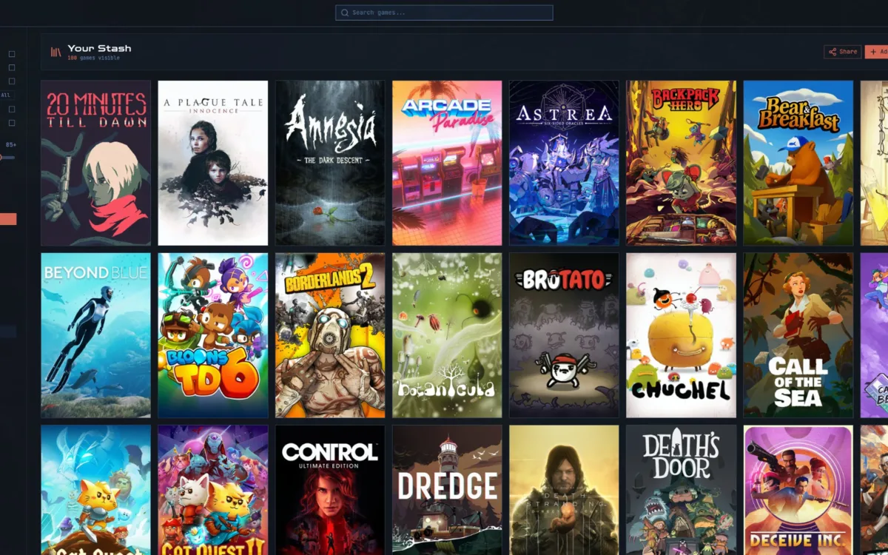
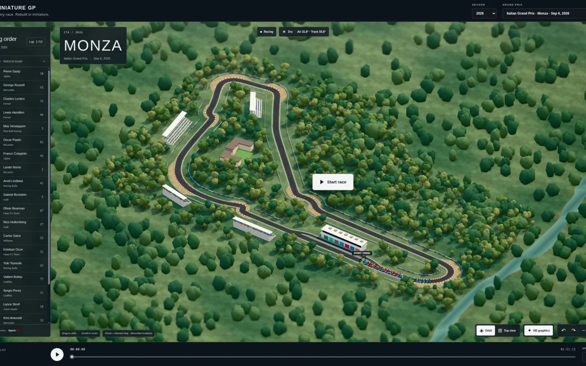
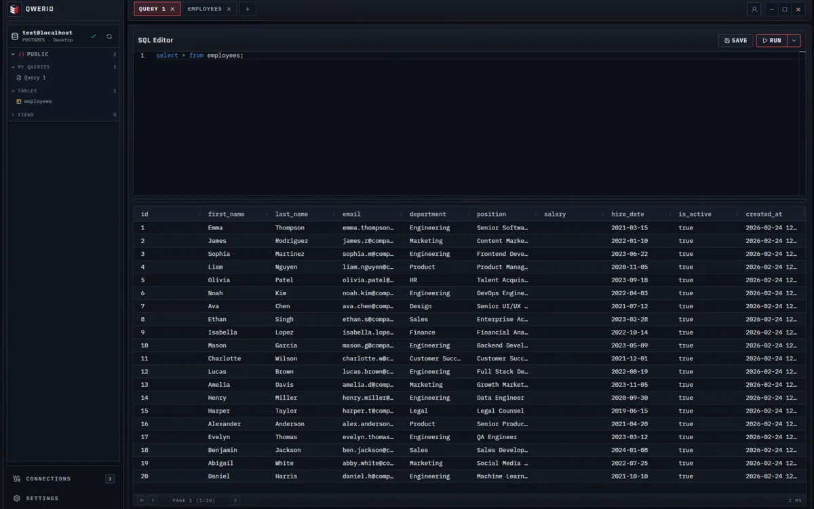
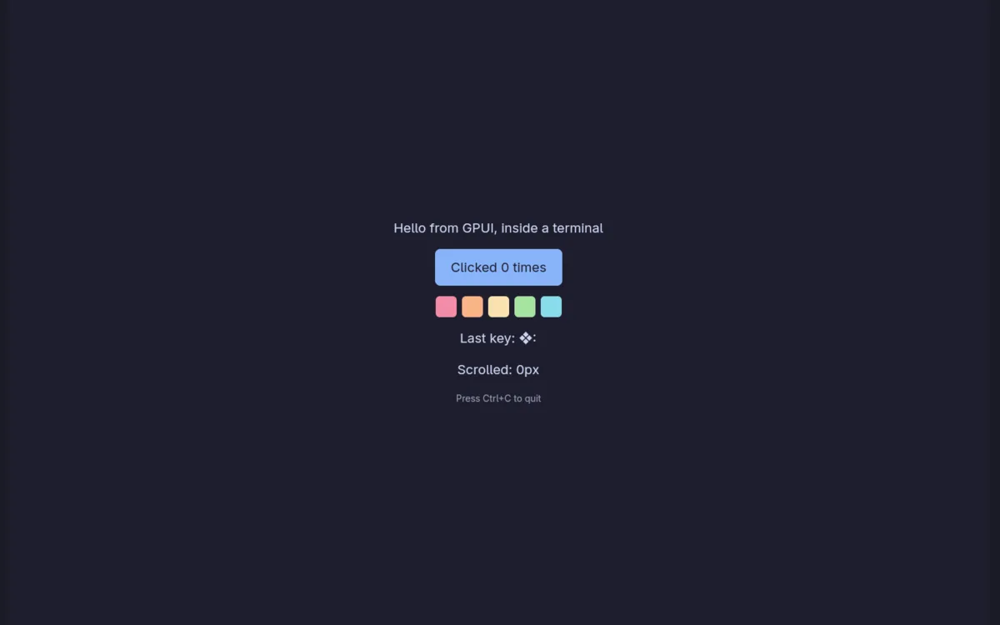
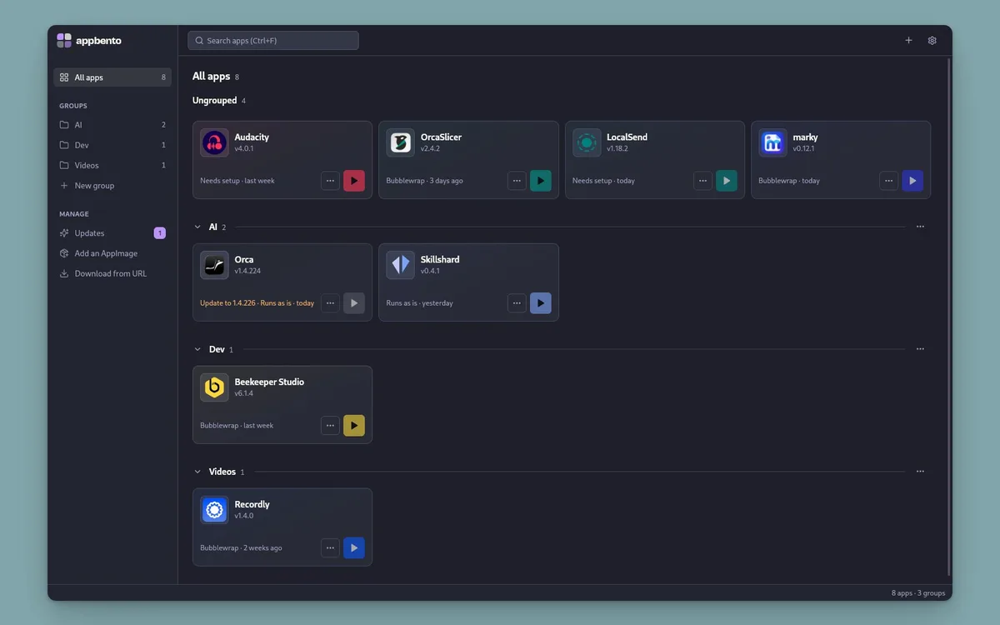
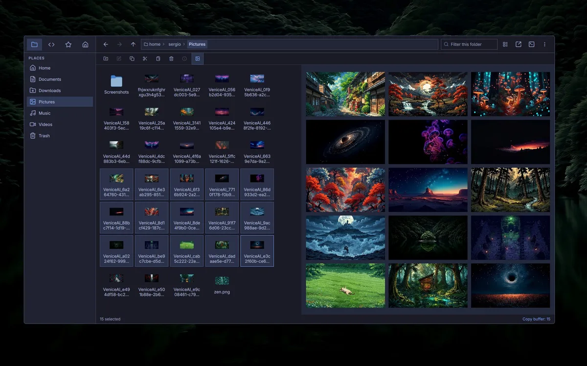

<p align="center">
  <a href="https://x.com/sergionoodle"></a>
</p>


### `~❯ cat bio.md`

I've spent two decades designing systems that couldn't afford to fall over: telecom billing, core banking, regulatory fintech, Web3 social. If it ships, I've probably debugged it at 3am.

These days I'm a solo builder at **Coding Noodles**, finding out how far one person can go with AI as a co-pilot. Linux is home, and I have a soft spot for retro terminal interfaces. You may have noticed.

### `~❯ ~/bin/activity.sh`




### `~❯ ls -lrt ~/projects | pr -2 -t`

Freshly made, served hot. Most of them are open source.

<table>
  <tr>
    <td width="50%" align="center">
      <a href="https://pixelstash.cc"></a>
      <br>
      <a href="https://pixelstash.cc"><b>PixelStash</b></a>
      <br>
      <sub>Every PC game you own, in one library</sub>
    </td>
    <td width="50%" align="center">
      <a href="https://minigp.cc"></a>
      <br>
      <a href="https://minigp.cc"><b>Miniature GP</b></a>
      <br>
      <sub>Formula 1 races as 3D replays</sub>
    </td>
  </tr>
  <tr>
    <td width="50%" align="center">
      <a href="https://github.com/sergionoodles/qwerio"></a>
      <br>
      <a href="https://github.com/sergionoodles/qwerio"><b>Qwerio</b></a>
      <br>
      <sub>A database workspace that feels like a file manager</sub>
    </td>
    <td width="50%" align="center">
      <a href="https://github.com/sergionoodles/gpui-tui"></a>
      <br>
      <a href="https://github.com/sergionoodles/gpui-tui"><b>gpui-tui</b></a>
      <br>
      <sub>GPUI apps, inside your terminal</sub>
    </td>
  </tr>
  <tr>
    <td width="50%" align="center">
      <a href="https://github.com/sergionoodles/appbento"></a>
      <br>
      <a href="https://github.com/sergionoodles/appbento"><b>AppBento</b></a>
      <br>
      <sub>Your AppImages, organized and sandboxed</sub>
    </td>
    <td width="50%" align="center">
      <a href="https://github.com/sergionoodles/filesail"></a>
      <br>
      <a href="https://github.com/sergionoodles/filesail"><b>FileSail</b></a>
      <br>
      <sub>A Quickshell file manager for Niri</sub>
    </td>
  </tr>
</table>


### `~❯ ~/bin/skills.sh`

<p>
  
</p>

```text
apps    rust · gpui · tauri · c++/qt 6 · qml/quickshell
web     typescript · vue/nuxt · react · three.js · vite · tailwind · cloudflare workers
linux   niri · noctalia · omarchy/hyprland · wayland
before  java · scala · big data · core banking · telecom billing   # the 20 years pre-AI
```


<p align="center">
  <code>~❯ exit</code><br>
  <sub>Thanks for stopping by. The noodles are getting cold. 🍜</sub>
</p>
